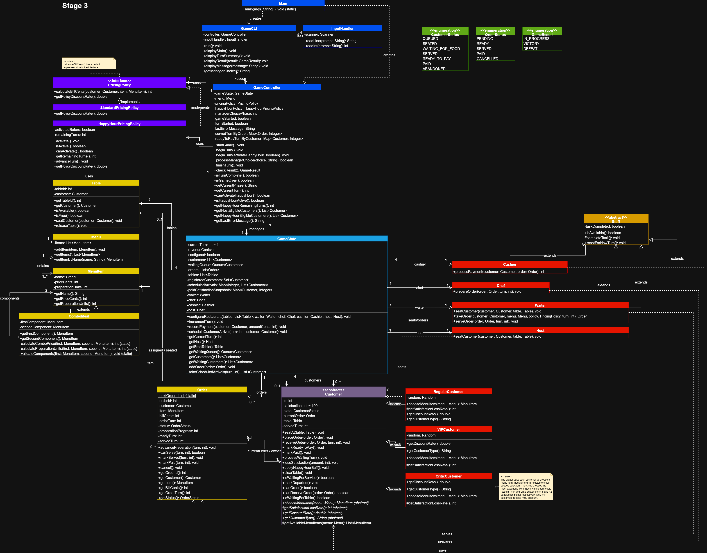
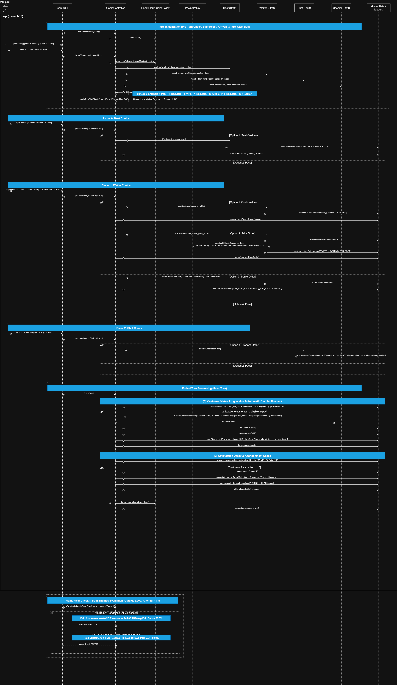

# Restaurant Rush Stage 3

Java command-line restaurant management game for SC2002/SC2302. The manager runs an 18-turn service with two tables and decides which customers to seat, which orders to prepare and serve, and when to activate Happy Hour.

[Group repository](https://github.com/aacceeOP/sc2005-scs3-group-5-group-assignment) · [Stage 1 snapshot](https://github.com/aacceeOP/sc2005-scs3-group-5-group-assignment/tree/stage-1) · [Stage 2 snapshot](https://github.com/aacceeOP/sc2005-scs3-group-5-group-assignment/tree/stage-2) · [Stage 3 gameplay commit](https://github.com/aacceeOP/sc2005-scs3-group-5-group-assignment/tree/0432121a73787da268c1f5b49c22783d471290d8)

## Stage 3 scope

Stage 3 adds a Host, a combo meal and a once-per-game Happy Hour. The Host can seat a customer while the Waiter uses the same turn to take an order or serve a dish. The Chef still prepares one unit per turn, so the manager must decide when to spend three kitchen turns on a combo.

Six customers arrive with 100 satisfaction. The arrival turns are **1, 4, 7, 10, 13 and 16**, in the order **Regular, VIP, Regular, Critic, Regular, Regular**.

| Menu item | Price | Preparation units |
| --- | ---: | ---: |
| Salad | $9.00 | 1 |
| Burger | $15.00 | 1 |
| Pasta | $18.00 | 2 |
| Salad + Pasta | $24.30 | 3 |

The combo contains the existing Salad and Pasta items. Its price is 90% of their combined price, rounded to the nearest cent. Its preparation time is the sum of their preparation units.

Customers choose their own food when the Waiter takes the order. The combo is available through the same selection rules as the other items. Each Regular and VIP has its own random-number generator. A fixed seed makes its choices repeatable when the menu order is the same.

| Customer | Satisfaction lost per waiting turn | Customer discount | Selection rule |
| --- | ---: | ---: | --- |
| Regular | 8 | None | Each Regular uses seed `12345`. Its first Stage 3 choice is Burger. |
| VIP | 5 | 10% | Each VIP uses seed `67890`. Its first Stage 3 choice is Salad + Pasta. |
| Critic | 12 | None | Chooses the most expensive item, taking the first in menu order if prices tie. In Stage 3 this is Salad + Pasta. |

## Build and run

Install a JDK and make `java` and `javac` available on `PATH`. The game was verified with JDK 26.0.2.1 and runs offline using the Java standard library.

From the repository root, run these commands in PowerShell:

```powershell
New-Item -ItemType Directory -Force build/classes | Out-Null
$javaSources = @(Get-ChildItem src/main/java -Recurse -Filter *.java |
    Select-Object -ExpandProperty FullName)
javac -d build/classes @javaSources
```

After compilation succeeds, launch a fresh game:

```powershell
java -cp build/classes restaurantrush.Main
```

## Controls and turn rules

| Prompt, in turn order | Choices |
| --- | --- |
| Happy Hour, while activation is available | **1** activate now, **2** skip this turn |
| Host | **1** seat a queued customer at a free table, **2** pass |
| Waiter | **1** seat, **2** take an order, **3** serve a ready order, **4** pass |
| Chef | **1** prepare one unit of an order, **2** pass |

Enter the displayed customer or order ID when prompted. The Host and Waiter each have their own action. If two tables are free, both can seat a customer in the same turn. An invalid choice shows an error and lets the manager retry without consuming that staff member’s action.

**Happy Hour.** Activation lasts for the current turn and the next. The CLI displays the remaining duration. At the start of each active turn, after arrivals, customers waiting for a table, an order or food recover 15 satisfaction, capped at 100. Orders placed during those turns receive 20% off after any VIP discount. Bills are stored in cents and locked when the Waiter takes the order. A VIP combo therefore costs `$24.30 × 0.90 × 0.80 = $17.50` after rounding, even if the Cashier collects payment several turns later.

**Preparation and serving.** The Chef can work on an order taken that turn. Finishing the last unit makes the order `READY`. Because the Waiter acts before the Chef, the earliest serving opportunity is the following turn.

**Payment and abandonment.** A customer served on turn T becomes `READY_TO_PAY` at the end of T+1 and can pay from T+2. The Cashier automatically collects at most one eligible payment per turn, oldest-ready first. Payment records revenue and the customer’s satisfaction, then frees the table. At turn end, unserved customers lose satisfaction at their type’s rate. At zero, they leave without paying, any unfinished order is cancelled, and their table is released.

**Result.** The game runs all 18 turns. Victory requires **at least four paid customers, at least $45.00 revenue, and average paid satisfaction of at least 60**. Otherwise the result is defeat. The average uses satisfaction recorded at payment and displays `N/A` until someone pays.

## Stage 3 verification

The Stage 3 source compiled with JDK 26.0.2.1. Each replay was run twice in fresh Java processes and produced identical output both times.

| Replay | Result | Served | Unhappy departures | Paid | Revenue | Average paid satisfaction | Turns |
| --- | --- | ---: | ---: | ---: | ---: | ---: | ---: |
| Victory | VICTORY | 6 | 0 | 5 | $86.80 | 82.8 | 18 |
| Defeat | DEFEAT | 0 | 2 | 0 | $0.00 | N/A | 18 |

### Reproduce the victory

Start a fresh game. Skip Happy Hour on turns 1–3 and activate it on turn 4. In the table, **Seat** and **Take order** use customer IDs. **Serve** and **Prepare** use order IDs. A dash means choose the staff member’s **Pass** option.

| Turn | Host | Waiter | Chef |
| ---: | --- | --- | --- |
| 1 | Seat 1 | Take order 1 | Prepare 1 |
| 2 | — | Serve 1 | — |
| 3 | — | — | — |
| 4 | Seat 2 | Take order 2 | Prepare 2 |
| 5 | — | — | Prepare 2 |
| 6 | — | — | Prepare 2 |
| 7 | Seat 3 | Serve 2 | — |
| 8 | — | Take order 3 | Prepare 3 |
| 9 | — | Serve 3 | — |
| 10 | Seat 4 | Take order 4 | Prepare 4 |
| 11 | — | — | Prepare 4 |
| 12 | — | — | Prepare 4 |
| 13 | Seat 5 | Serve 4 | — |
| 14 | — | Take order 5 | Prepare 5 |
| 15 | — | Serve 5 | — |
| 16 | Seat 6 | Take order 6 | Prepare 6 |
| 17 | — | Serve 6 | — |
| 18 | — | — | — |

Turn 4 demonstrates price locking in both directions. The Cashier collects **$15.00** for customer 1’s Burger, ordered before Happy Hour. On that same turn, the VIP orders Salad + Pasta for **$17.50**. The Chef finishes the combo on turn 6, the Waiter serves it on turn 7, and the VIP pays on turn 9 after Happy Hour has expired. Customer 6 is served on turn 17 and becomes ready to pay on turn 18, which accounts for six served but only five paid.

### Reproduce the defeat

Start a fresh game. On every turn, choose **2** to skip Happy Hour, **2** for the Host to pass, **4** for the Waiter to pass, and **2** for the Chef to pass. Two customers reach zero satisfaction. After turn 18, revenue is $0.00 and average paid satisfaction is `N/A`.

## Changes between stages

### Stage 1 → Stage 2

Stage 2 introduced different customer behaviour while retaining one service and payment flow. The `VIPCustomer.java` and `CriticCustomer.java` files already existed in Stage 1. Stage 2 implemented their selection, satisfaction-loss and discount rules. `Customer.java` and `RegularCustomer.java` were updated to expose customer type labels. `Main.java` registered the mixed arrival schedule, and `GameCLI.java` displayed customer types and order details. The README was updated and the Stage 2 class diagram was added. No Java files were added or deleted in this transition. [Compare Stage 1 and Stage 2](https://github.com/aacceeOP/sc2005-scs3-group-5-group-assignment/compare/stage-1...stage-2)

### Stage 2 → Stage 3

The Stage 3 gameplay commit modified eight existing Java files. No Java files were added or deleted. [Compare Stage 2 and the Stage 3 gameplay commit](https://github.com/aacceeOP/sc2005-scs3-group-5-group-assignment/compare/stage-2...0432121a73787da268c1f5b49c22783d471290d8)

| Changed file | Reason |
| --- | --- |
| `Host.java` | Implemented seating with the Host’s own inherited per-turn task allowance. |
| `ComboMeal.java` | Used two existing `MenuItem` components to calculate one menu item’s price and preparation units. |
| `HappyHourPricingPolicy.java` | Tracked one-time activation and remaining turns, and supplied the active discount through `PricingPolicy`. |
| `Customer.java` | Added the capped Happy Hour satisfaction recovery used across customer types. |
| `GameState.java` | Registered the Host alongside the existing restaurant staff. |
| `GameController.java` | Coordinated activation, turn-start recovery, the Host phase and selection of the pricing policy when an order is taken. |
| `GameCLI.java` | Added activation and Host prompts and displayed Happy Hour status and eligible customers. |
| `Main.java` | Created the Host and registered Salad + Pasta using the existing menu components. |

The Waiter, Chef, Cashier and Order classes continued to handle the service flow. The three-unit combo exercised the Chef’s existing preparation logic. The two turn-4 bills verified that activating Happy Hour changes new orders while preserving the price of an earlier order.

## Diagrams

[Stage 1 class diagram](docs/diagrams/stage-1-class-diagram.png) · [Stage 2 class diagram](docs/diagrams/stage-2-class-diagram.png)



[Open the full-resolution Stage 3 class diagram](docs/diagrams/stage-3-class-diagram.png)



[Open the full-resolution Stage 3 sequence diagram](docs/diagrams/stage-3-sequence-diagram.png)

The Stage 3 sequence diagram follows the manager’s choices through the CLI, controller, staff and game state. The VIP replay gives one concrete path through its alternatives. At the start of turn 4, Happy Hour is available, the VIP is due to arrive, and a table is free. The manager activates Happy Hour, assigns the Host to seat the VIP, and uses the Waiter’s action to take the order immediately. That decision locks in the $17.50 bill. The diagram then follows preparation, serving, payment and table release through to the result check after turn 18.

## Individual AI histories and recorded presentation

Each member’s full project-related AI history belongs on their personal branch. **Pending for submission:** add each member’s name and history link, followed by the recording location and the actual start time of each segment below.

| Presentation segment | Start time |
| --- | --- |
| Launching the game from the submitted project | Pending |
| Manager decision with competing staff tasks | Pending |
| One dish progressing from `READY` to `SERVED` to payment | Pending |
| VIP or Critic behaviour | Pending |
| Stage 3 feature demonstration | Pending |
| Reproducible victory and defeat | Pending |
| Stage comparisons and diagrams | Pending |
